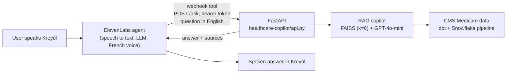

# Outpatient Care Readmissions Pipeline

An end-to-end analytics engineering project that ingests, validates, transforms, and analyzes outpatient care, patient experience, and readmissions-related data, with a final Tableau dashboard used to surface state-level patterns in predicted readmission rates, risk burden, cost pressure, and patient satisfaction. The pipeline also powers an AI layer: a RAG copilot that answers questions about the data, and a voice agent that answers those questions out loud in Haitian Creole.

## Overview

This project began as a healthcare data pipeline and evolved into a full analytics engineering capstone. My goal was to move beyond simple reporting by building a workflow that could ingest and validate source data, transform it into analysis-ready structures, and support business facing insights through Tableau.

The final output is a state-level dashboard exploring how predicted readmission rates relate to patient survey ratings, average risk score, and cost per patient. In addition to building the technical workflow, I used this project to work through data modeling decisions, metric interpretation, and the challenge of turning pipeline outputs into a coherent analytical story. This is also a chance for me to use all of these tools at once as I have been limited in certain environments due to security reasons.

## Business Problem

Healthcare stakeholders need trustworthy, analysis ready data to understand patterns tied to patient outcomes and care experience. I personally started this wondering "Where are the places in America that people are happy within their provider system?" In this project, I explored how readmissions related metrics, patient satisfaction, and cost/risk indicators could be combined to answer questions such as:

- Which states show the highest predicted readmission rates?
- Is higher patient risk associated with higher readmission rates?
- Is lower patient satisfaction associated with worse readmission outcomes?
- How might cost pressure affect patient experience and operational performance?

This project was designed to show both the technical pipeline required to support analysis and the business-facing dashboard used to communicate results.

## Final Dashboard

https://public.tableau.com/app/profile/rooscol.rozambert/viz/HealthcareReadmissionsDashboard_17741121167600/Dashboard1

The final Tableau dashboard, **Healthcare Readmissions Dashboard**, presents:

- A U.S. map highlighting where predicted readmission rates are highest
- A Top 10 states ranking by average predicted readmission rate
- A scatterplot comparing average risk score vs. predicted readmission rate
- A scatterplot comparing average patient survey star rating vs. predicted readmission rate
- Additional context using cost per patient and narrative interpretation to explain state level variation and outliers

## Key Questions Answered

This dashboard and pipeline were built to explore the following questions:

- Where are predicted readmission rates highest?
- Do higher-risk states also show higher readmission rates?
- Are lower patient satisfaction scores associated with worse readmission performance?
- Which states appear to be outliers, and what operational or demographic factors might help explain them?

## Project Evolution

This project changed substantially as I worked through it.

### Phase 1: Pipeline Build
I initially focused on getting the technical pipeline running end to end, including ingestion, validation, and orchestration.


### Phase 2: Debugging and Reliability
As the project developed, I ran into validation and execution issues that forced me to rethink pieces of the implementation. This stage made the project stronger by pushing me to focus on reliability, not just first-pass execution. 

First, creating the tests and schema yaml was paramount. After a few failures, seeing that certain columns and models couldn't be tested the same helped these pass 


As well as in the marts:


### Phase 3: Data Understanding and Modeling
Once the pipeline was more stable, my attention shifted to the data itself: table grain, join logic, metric definitions, and how sources such as readmissions, patient experience, and provider-related data should be connected and communicated. 


### Phase 4: Analytics Framing
The project then evolved from technical infrastructure into analytical storytelling. I began testing relationships between patient satisfaction, cost, ailments, risk score, and predicted readmission burden to identify useful patterns and possible business interpretations/solutions.


### Phase 5: Dashboard and Communication
Finally, I translated the analysis into Tableau so the pipeline outputs could be consumed visually and interpreted more easily by a stakeholder audience.


Interactive Dashboard:

https://public.tableau.com/app/profile/rooscol.rozambert/viz/HealthcareReadmissionsDashboard_17741121167600/Dashboard1

### Phase 6: AI Copilot
With the state-level tables in place, I added a retrieval augmented generation (RAG) copilot so stakeholders can ask questions in plain English instead of reading the dashboard. See [AI Layer](#ai-layer).

### Phase 7: Voice Agent in Haitian Creole
I then connected the copilot to an ElevenLabs voice agent through an authenticated API, so the same data can be queried by voice in Haitian Creole. See [Voice Agent in Haitian Creole](#voice-agent-in-haitian-creole-elevenlabs).

## Tech Stack

- **Pipeline:** Python, SQL, Snowflake, dbt, Airflow, Docker
- **Analytics:** Tableau
- **AI layer:** LangChain, FAISS, OpenAI GPT-4o-mini, Streamlit
- **Voice agent:** ElevenLabs Agents, FastAPI, ngrok
- **Tooling:** GitHub

## Data Sources

This project combines multiple healthcare-related datasets to support readmissions analysis and patient experience exploration.

### Readmissions Data
Used as the central outcome oriented dataset for comparing predicted readmission rates across states.
https://data.cms.gov/provider-data/dataset/9n3s-kdb3

### Patient Experience / Survey Data
Used to bring in average patient survey star ratings and better understand how patient experience relates to readmissions. 
https://data.cms.gov/provider-data/dataset/dgck-syfz

### Risk and Cost Metrics
Used to compare average risk burden and cost per patient across states.

### Provider / Healthcare Context Data
Used to support broader modeling, joins, and interpretation throughout the project workflow.
https://data.cms.gov/provider-summary-by-type-of-service/medicare-physician-other-practitioners/medicare-physician-other-practitioners-by-provider-and-service/data

## Pipeline and Transformation Workflow

The project follows a staged analytics engineering workflow:

- Ingest raw healthcare data into Snowflake
- Validate source quality and build Airflow orchestration
- Run dbt staging and marts to create analysis-ready tables
- Debug transformation and testing issues until the workflow ran reliably
- Clarify table grain, joins, and metric definitions
- Build a state-level summary model for downstream analysis
- Test relationships between readmission, risk, satisfaction, services, and cost
- Translate the findings into a Tableau dashboard

A major part of the project involved moving from raw technical execution into clearer metric definitions and business ready outputs and thinking downstream as I am planning on expanding this with more quality of life measures. 

## Tableau Dashboard Design

Link to dashboard: https://public.tableau.com/app/profile/rooscol.rozambert/viz/HealthcareReadmissionsDashboard_17741121167600/Dashboard1

The Tableau dashboard was designed around a few core analytical views:

### Geographic Overview
A state-level map helps identify where predicted readmission rates are concentrated geographically.

### Ranked Comparison
A Top 10 bar chart highlights the highest-readmission states for fast comparison.

### Risk vs. Readmission
A scatterplot shows the positive relationship between average risk score and average predicted readmission rate.

### Satisfaction vs. Readmission
A second scatterplot shows the inverse relationship between patient satisfaction and predicted readmission rate.

### Narrative Interpretation
A written text block summarizes patterns, likely drivers, and meaningful outliers such as New Jersey, Utah, Alaska, or other states depending on the cut and interpretation.

## AI Layer

### RAG Copilot (Streamlit)

`healthcare-copilot/` contains a chat interface over the state-level outputs of the pipeline.

- `ingest.py` turns the state-level tables into documents and builds a FAISS index using OpenAI `text-embedding-3-small`
- `app.py` is a Streamlit chat app that retrieves the 6 most relevant chunks (k=6) and answers with GPT-4o-mini at temperature 0.2, citing the states and sources it used
- Suggested questions cover cancer rate anomalies, high cost with low satisfaction, readmission drivers, and out-of-pocket costs

### Voice Agent in Haitian Creole (ElevenLabs)

<!-- Demo video link goes here -->

An ElevenLabs voice agent that answers questions about CMS Medicare outpatient data **out loud, in Haitian Creole (Kreyòl ayisyen)**. The agent does not hold any data itself. It calls this pipeline through a small authenticated API, so every answer comes from the same dbt modeled data and RAG copilot that power the Streamlit app.

#### Why

Haitian Creole speakers are a large patient population in the US, and most healthcare voice AI only works well in English. This project tests whether a voice agent can be pointed at a real healthcare data pipeline and serve a language that the platform does not officially support.

#### Architecture



1. The user asks a question by voice in Creole.
2. The agent decides the question needs data and calls the `query_readmissions_data` webhook tool, translating the question into English (the FAISS index and source data are in English).
3. `api.py` runs the same retrieval chain as the Streamlit app, with a prompt tuned for speech: 2 to 4 short sentences, specific states and numbers, and an explicit "say so if the data does not contain the answer, never invent numbers."
4. The API returns the answer plus the retrieved sources, and the agent speaks it back in Creole.

The language handling lives entirely in the agent layer. The data pipeline stays unchanged and only ever sees English.

#### Language support findings

| Finding | Detail |
|---|---|
| Creole is not in the agent language list | ElevenLabs agents do not list Haitian Creole as a supported language. |
| Workaround | Agent language set to **French**, a French voice (Hugo), and a system prompt instructing the LLM to always reply in Kreyòl, never French or English. |
| Speech output | Natural, easily understood Creole. As a Creole speaker, I found the French accent a good fit given how close the languages are. |
| Speech to text | Spoken Creole is often **transcribed as French** (for example "dépenses" for "depans"). The LLM still recovered the intent, and when it was unsure it asked a clarifying question in Creole instead of guessing. |
| Safety behavior | When the tool was failing during setup, the agent told the user it could not reach the data instead of making up numbers. |

#### Example exchange

> **User (spoken Creole):** asks which states have high costs but low patient satisfaction
>
> **Agent:** *"Eta ki gen pi gwo depans pou chak pasyan se Nevada, ak kat san wit dola pou chak pasyan. Washington D.C. vini jis apre ak de san katreven senk dola."*
>
> (The state with the highest cost per patient is Nevada, at $408 per patient. Washington D.C. comes right after at $285.)

Accuracy of these answers is being checked against the dbt marts directly (see Known limitations).

#### API

`POST /ask` (in `healthcare-copilot/api.py`)

```bash
curl -X POST https://<host>/ask \
  -H "Authorization: Bearer $TOOL_TOKEN" \
  -H "Content-Type: application/json" \
  -d '{"question": "Which states have high cost but low satisfaction?"}'
```

```json
{
  "answer": "Delaware has a high cost per patient of 289.13 USD and a patient satisfaction star rating of 3.42 out of 5. ...",
  "sources": ["Delaware · Physician State Metrics", "Wyoming · State Healthcare Analysis", "..."]
}
```

`GET /health` returns `{"status": "ok"}`.

**Security:** requests must carry a bearer token (`TOOL_TOKEN`), compared in constant time. The token and the OpenAI key are read from environment variables and are never committed. In ElevenLabs, the `Authorization` header is stored as a workspace secret, not as plain text in the tool config.

#### Run it locally

```bash
cd healthcare-copilot
pip install fastapi uvicorn
# .env needs OPENAI_API_KEY and TOOL_TOKEN
python -c "import secrets; print(secrets.token_urlsafe(32))"   # generate TOOL_TOKEN
uvicorn api:app --reload --port 8000
ngrok http 8000 --url <your-static-ngrok-domain>   # expose it to the ElevenLabs webhook tool
```

The ngrok inspector at `http://127.0.0.1:4040` shows every call the agent makes, which made debugging the webhook (including a 401 from mismatched tokens) straightforward.

#### Known limitations

- **Ranking questions.** Retrieval pulls the top 6 chunks, so "which state is highest" questions only compare the states that were retrieved, not all 50. RAG is the wrong tool for aggregate rankings.
- **Speech to text** treats spoken Creole as French, so transcripts are not accurate Creole even when the answer is correct.
- **Hosting.** The API currently runs locally behind ngrok, so the agent only works while it is running.
- **Not medical advice.** The agent answers questions about aggregate public CMS data only. It uses no patient data and does not diagnose.

#### Next

- [ ] Evaluation set: about 15 to 20 questions in English and Creole, scored against values computed directly from the dbt marts
- [ ] Deploy the API to Cloud Run with Terraform (Artifact Registry, Secret Manager, least-privilege service account, scale to zero)
- [ ] Add a SQL tool for ranking and aggregate questions, keeping RAG for explanations
- [ ] Post-discharge check-in agent in Creole whose structured call data lands in the dbt models
- [ ] Test with additional native Creole speakers

## Key Findings

This project produced several directional findings:

- States with higher average risk scores generally showed higher predicted readmission rates
- Lower patient satisfaction tended to align with higher predicted readmission burden
- Cost pressure appeared relevant to patient experience, though it was not always the strongest explanatory factor
- Some states behaved like outliers, suggesting that local health culture, demographics, care coordination, or system complexity may matter alongside cost and risk burden

These findings are exploratory and meant to support discussion, not claim definitive causality.

## Challenges and Iterations

Some of the most important challenges in this project included:

- Debugging source validation and pipeline execution issues
- Rethinking parts of the workflow when the initial structure was not sufficient
- Clarifying the grain and meaning of each dataset before joining
- Interpreting healthcare metrics carefully enough to avoid misleading comparisons
- Translating a technically complex workflow into a clean dashboard and story

This was one of the most valuable parts of the project because it pushed me to think like both a data engineer and an analytics engineer. This also was a large set of data so it made me have to think of memory and efficiency more than other projects and tasks at work. 

## Lessons Learned
Raw tables should usually stay close to the source, and if the column names, formats, or structure are awkward, the staging layer is the right place to standardize them.

I learned that relying on awkward raw column names makes downstream SQL and dbt models harder to maintain. When raw column references become brittle, renaming and standardizing them in staging is often the cleanest long-term solution.
I learned that getting the SQL to run is not enough. Before comparing metrics, I had to understand the grain of each table and whether the measures were actually comparable at the level of analysis I wanted. A successful pipeline run does not automatically mean the analysis is correct. I had to distinguish between technical completion and analytical validity.

## How to Run the Project
### 1. Clone the repository

```bash
git clone https://github.com/roscoedela/outpatient-care-readmissions-pipeline.git
cd outpatient-care-readmissions-pipeline
```
### 2. Set up a virtual environment

```bash
python -m venv .venv
source .venv/bin/activate
```
### 3. Install dependencies

```bash
pip install -r requirements.txt
```

### 4. Confirm required tools and access

Before running the project, make sure you have:

- Python
- Docker
- Airflow
- dbt
- Snowflake access
- Tableau Public or Tableau Desktop
- An OpenAI API key (for the copilot and voice agent API)

### 5. Run the copilot

```bash
cd healthcare-copilot
python ingest.py          # builds the FAISS index
streamlit run app.py
```

To run the voice agent API, see [Run it locally](#run-it-locally).

## Repository Structure

```bash
outpatient-care-readmissions-pipeline/
├── airflow/              # Airflow configuration
├── dags/                 # pipeline DAGs
├── ingestion/            # fetch, validate, and load raw data to Snowflake
├── dbt/                  # dbt project
├── healthcare_dbt/       # dbt staging and marts models
├── data_quality/         # source validation
├── healthcare-copilot/
│   ├── ingest.py         # builds the FAISS index
│   ├── app.py            # Streamlit RAG copilot
│   ├── api.py            # FastAPI endpoint for the ElevenLabs voice agent
│   └── faiss_index/
├── diagrams/             # ERD and architecture diagrams
├── docs/
├── scripts/
├── tests/
├── Dockerfile
└── README.md
```
